# 实验二报告：房源采集与 MySQL 存储

- 班级：数据1241
- 姓名：郑佳敏
- 学号：112413070416
- 实验日期：2026-11-06
- GitHub 仓库链接：https://github.com/Zjm06200/bigdata-collection-labs-112413070416
- 源码文件名：`lab02/anjuke.ipynb`
- 数据库与表：`smartpark_lab.houseinfo`
- 数据来源：在线教学站 `http://www.bspider.top/anjuke/`（在线采集，非快照）
- 访问时间及结果（若失败，填写状态码、页面标题或报错）：2026-11-06 访问，状态码 200，每页返回 60 条房源（`div.property` 卡片）。注意：请求头 UA 必须使用完整浏览器 UA（Chrome/120），否则教学站返回"访问验证-安居客"验证页，页面状态码仍为 200 但房源数为 0。
- 快照文件来源与文件名（在线实验可写"不适用"）：不适用（在线实验）。

> 填写要求：截图放在 `images/` 中，在对应位置插入图片。代码截图要显示文件名、行号或单元位置，用红框标出关键代码，每项写2—3句话解释。只截最终结果或只贴 AI 生成的文字，不能代替实验过程。未完成的项目写明原因，不填写预期结果，不展示个人账号密码。

## 第一阶段：MySQL Docker 更新与启动

- 本次是否需要更新：已完成更新（按 L05 增量更新包导入 mysql:8.4.11 镜像，镜像 ID 与 SHA256 校验均通过，使用 `l05-mysql-fresh-volume.yaml` 独立数据卷）。
- 更新或启动遇到的问题：首次启动时 compose 报 `STUDENT_ID` 变量为空——检查发现课程目录 `.env` 中学号未填写，补填学号后配置检查通过，`start-mysql.bat` 正常启动并通过 healthy 检查与账号连接测试（启动窗口未单独截图，连接成功可由图 3、图 7 佐证）。

### 启动环境与建表

依次使用 `start-course.bat`、`start-mysql.bat`、`mysql-console.bat` 启动课程环境、数据库和 MySQL 终端。

**截图：** MySQL 启动成功提示，以及终端中 `USE smartpark_lab`、`SHOW TABLES`、`DESCRIBE houseinfo` 的执行结果。可分图。

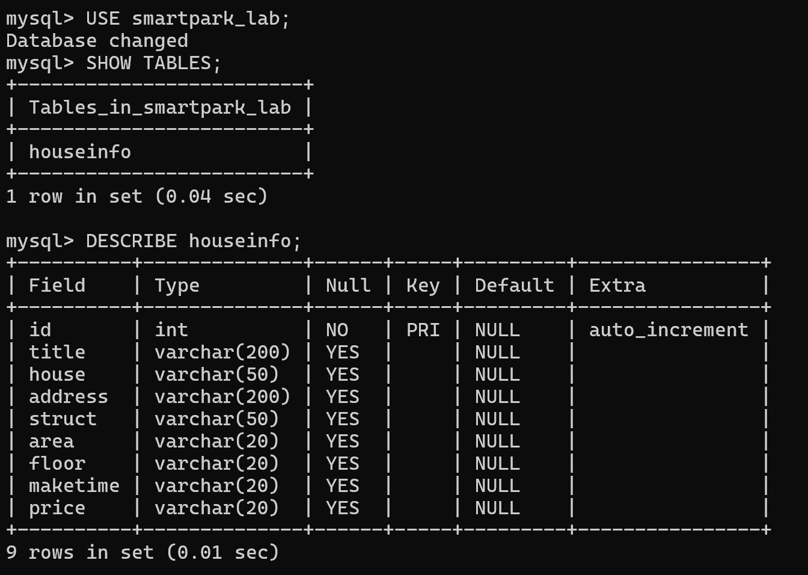

说明：当前使用哪个数据库？`id` 和8个房源字段分别保存什么？

答：当前使用 `USE smartpark_lab;` 切换到的 `smartpark_lab` 库，`SHOW TABLES` 显示只有 `houseinfo` 一张表。`id` 是自增主键（`DESCRIBE` 中 Key=PRI、Extra=auto_increment），8 个房源字段依次是：`title` 房源标题（varchar 200）、`house` 楼盘/小区名（varchar 50）、`address` 详细地址（varchar 200）、`struct` 户型如"3室2厅1卫"（varchar 50）、`area` 建筑面积如"89.9㎡"（varchar 20）、`floor` 楼层信息（varchar 20）、`maketime` 建造年代如"2019年建造"（varchar 20）、`price` 每平方米单价（varchar 20）。

## 第二阶段：房源采集与 CSV 数据存储

### 1. 网页分析与房源解析

#### 选择器是怎样得到的

在 Chrome 中按 F12，使用 **Elements → Copy → Copy selector**。选一个字段，记录从完整路径到相对选择器的过程。

- 选择的字段：title（房源标题）
- 复制的原始选择器：`#__layout > div > section > section.list-main > section.list-left > section:nth-child(4) > div:nth-child(1) > a > div.property-content > div.property-content-detail > div.property-content-title > h3`
- 一条房源的父容器选择器：`div.property`
- 最终使用的相对选择器：`h3.property-content-title-name`（在父容器 `row` 内调用 `row.select_one(...)`）

**截图：** 在 Chrome F12 Elements 面板中选中 title 字段节点，框出该 `h3` 节点和底部的面包屑层级链，展示选择器的匹配结果。

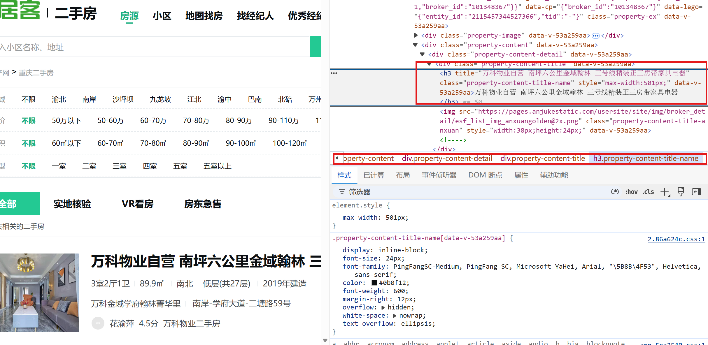

说明：红框 1 是 Inspect 选中后高亮的 `h3` 节点，`class="property-content-title-name"` 就是最终使用的相对选择器；红框 2 是面板底部的面包屑，显示它上层的 `div.property-content-title → div.property-content-detail → div.property-content` 链条。房源卡片最外层的父容器 `div.property` 在这条链的更上层，截图时已滚动出面板顶部，但其存在已由单元1 的 `len(rows)=60` 验证。

说明：删掉了哪些层级？怎样确认父容器刚好包含一条房源？

答：Chrome 复制出的选择器一共 12 层，开头是 `#__layout`，中间经过 `section.list-main`、`section.list-left`，还夹着 `section:nth-child(4)`、`div:nth-child(1)` 这种**按位置数的层级**——这些层级对定位没有帮助，而且页面一加广告位或调整栏目顺序就会失效。所以只保留两层：父容器 `div.property`（一条房源的最外层卡片）+ 卡片内字段的 class。确认方法：在单元1 中先取 `rows = page_soup.select("div.property")`，打印 `len(rows)` 为 60（正好等于页面上的房源数），再在单元2 中对 `rows[0]` 逐字段用相对选择器取值，取出的都是同一条房源的内容，说明父容器刚好包住一条房源。

#### 解析8个字段

**截图：** 自己编写的解析代码和首条房源的8个字段输出。代码中必须框出：

- `select()` 和 `select_one()`。
- 面积、单价的定位与取值。
- 建造年代的提取和缺失处理。

可分成几张局部截图。另附面积、单价对应的 HTML 节点或网页原文。

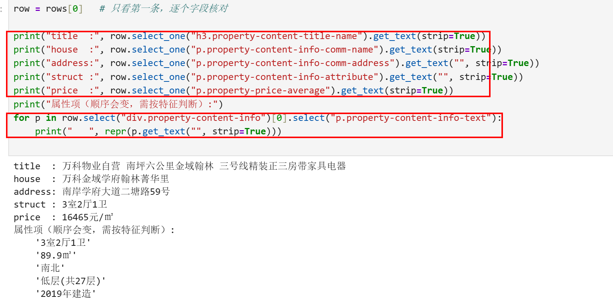

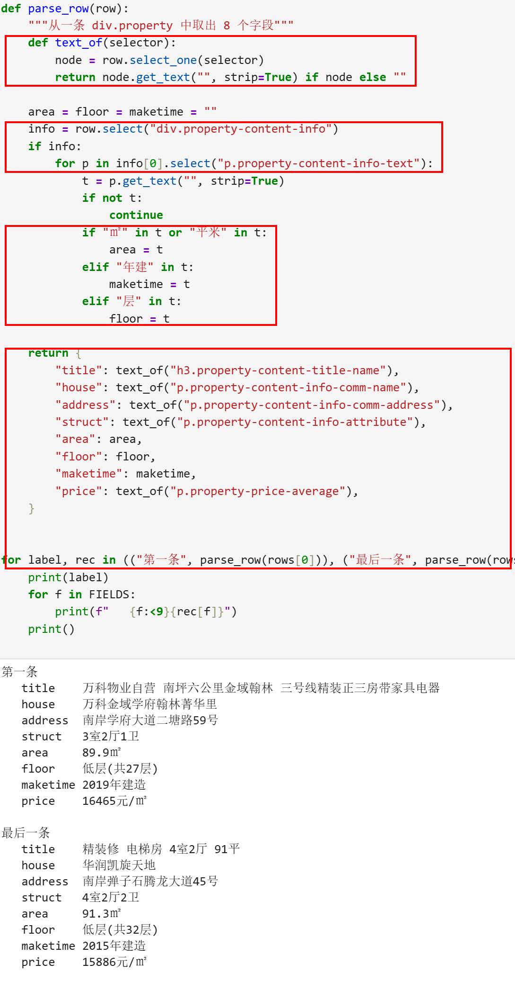

说明：两个选择方法各用在哪里？怎样确认面积和单价没有取错？

答：`select_one()` 用在"一个卡片里只有一个"的字段上（标题、楼盘、地址、户型、单价），它返回第一个匹配节点或 None；`select()` 用在返回列表的地方——`select("div.property")` 取整页所有房源卡片，以及 `info[0].select("p.property-content-info-text")` 取属性区里的多个属性项。面积和单价确认方法：面积在属性项里按"含 ㎡"的文字特征识别，单价用独立选择器 `p.property-price-average` 定位；单元2 的输出显示 `price: 16465元/㎡` 是每㎡单价而不是总价，且与网页上该房源显示的一致；`area: 89.9㎡` 与属性项列表中 `'89.9㎡'` 一致。由于属性项顺序会变，代码按特征判断而不是按位置取，避免取错列。

### 2. 下一页采集

- 下一页 `href` 原值：`?page=2`（相对地址）
- 用 `urljoin()` 补全后的地址：`http://www.bspider.top/anjuke/?page=2`
- 实际停止原因（明确禁用的末页按钮 / 异常中止）：正常停止——第 10 页后页面上没有 `a.next.next-active` 下一页按钮，`href` 为 None，`stop_reason = "下一页按钮不存在，已到末页"`。

**截图：** 框出提取 `href`、补全地址、循环更新地址和停止条件的代码。附前两页的运行日志，以及最终停止提示。离线实验展示快照中的href、补全结果和文件读取记录，注明"离线回放"，不算在线翻页成功。

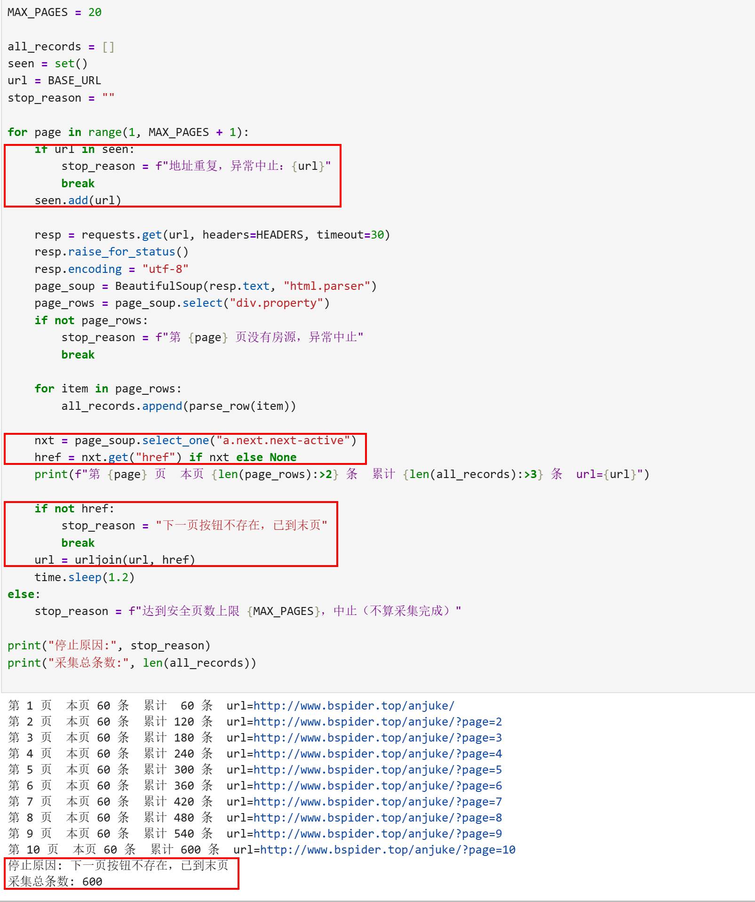

说明：怎样进入下一页？怎样防止重复采集或无限循环？

答：每页解析完后用 `page_soup.select_one("a.next.next-active")` 找"下一页"按钮，取其 `href`（首页为 `?page=2` 这样的相对地址），再用 `urljoin(url, href)` 拼成完整 URL 作为下一轮的请求地址。防重复/防死循环有三层：① `seen` 集合记录已请求过的 URL，地址重复就异常中止；② 请求间隔 `time.sleep(1.2)` 限速；③ `MAX_PAGES = 20` 安全上限。正常结束时因为末页没有下一页按钮，`href` 为 None 走 `break`，并记录 `stop_reason`。

### 3. 保存 CSV

**截图：** CSV保存与回读代码、回读条数。框出编码、表头和数据写入部分。

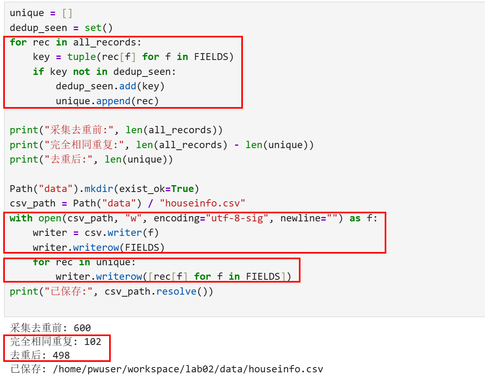

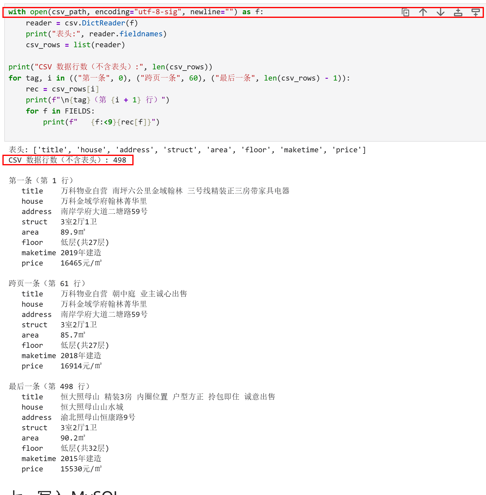

说明：8个字段的顺序是什么？按8个字段完全相同去重后，保存了多少条记录？

答：字段顺序与数据库建表一致：`title, house, address, struct, area, floor, maketime, price`。采集 600 条中按 8 个字段完全相同去重后剩 498 条（102 条是完全相同的重复记录，来自跨页重复展示的房源），回读核对 `CSV 数据行数（不含表头）: 498`，与保存的一致。编码用 `utf-8-sig`，这样 Excel 直接打开不会中文乱码。

## 第三阶段：MySQL 数据存储

### 1. 读取 CSV 并入库

本阶段读取第二阶段的 `data/houseinfo.csv`，不重新采集。

**截图：** 框出读取CSV、按8个字段整理入库参数的代码。

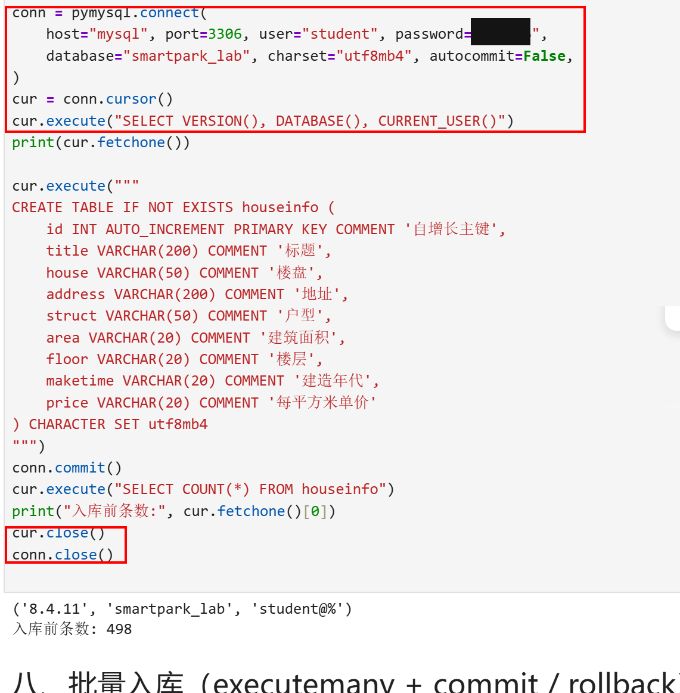

**截图：** 自己编写的入库代码。框出 `executemany()`、`commit()`、`rollback()`，以及关闭游标和连接的操作。另框出避免重复插入的代码。

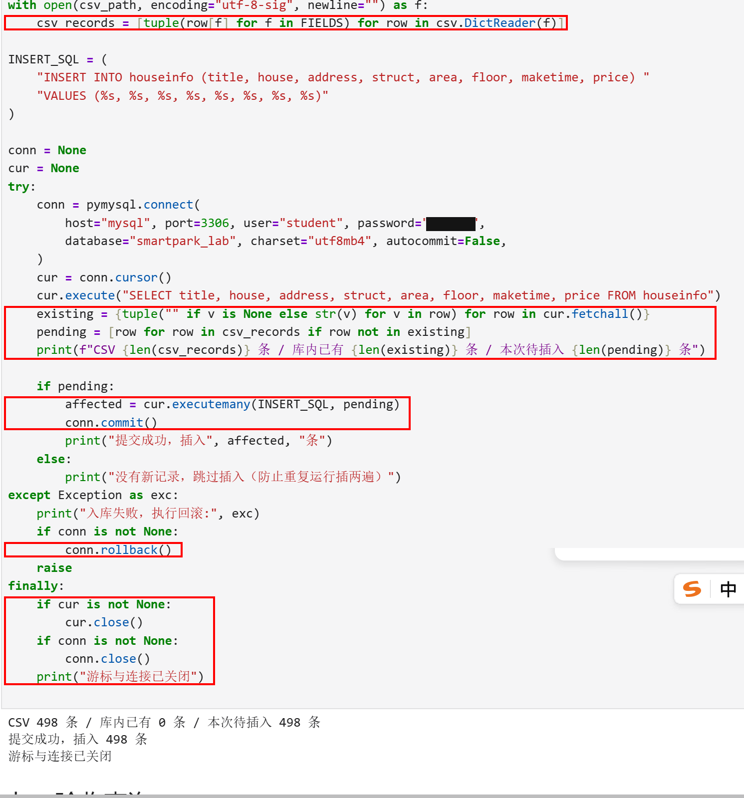

说明：每条记录怎样对应8个参数？成功、失败时分别做什么？再次运行时怎样避免重复插入？

答：SQL 写成 `INSERT INTO houseinfo (title, house, address, struct, area, floor, maketime, price) VALUES (%s,×8)`，每条记录用 `tuple(row[f] for f in FIELDS)` 按 FIELDS 顺序生成 8 个参数，`executemany(INSERT_SQL, pending)` 一次批量提交，参数与占位符一一对应。成功时 `conn.commit()` 提交并打印插入条数；任何一步出错进入 `except`，打印错误并 `conn.rollback()` 回滚整个事务后抛出异常，保证不会写入一半。防重复插入：入库前先 `SELECT` 出库内全部已有记录生成 `existing` 集合，只把 `pending = [不在 existing 里的行]` 送去插入；没有新记录就直接跳过。`finally` 里无论成败都关闭游标和连接。

### 2. 核对结果

#### 查询条数和样本

**截图：** MySQL 终端中的入库前后 `SELECT COUNT(*)`、重跑后的条数，以及 `SELECT ... LIMIT 5` 的结果。

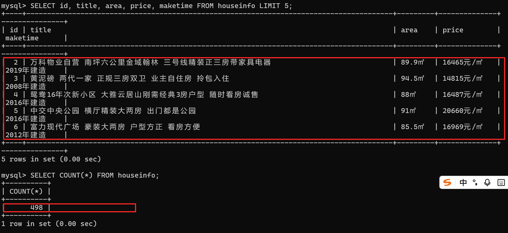

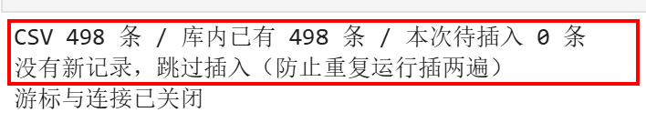

| 项目 | 实际结果 |
|---|---|
| 成功采集页数 | 10 |
| 采集记录数（去重前） | 600 |
| 完全相同的重复记录数 | 102 |
| CSV数据行数（不含表头） | 498 |
| 入库前条数 | 0 |
| 入库后条数 / 本次新增条数 | 498 / 498 |
| 关闭上次程序后，同批数据独立重跑的条数 / 新增条数 | 498 / 0 |
| 是否采集完整；未完成的原因 | 完整。共 10 页全部采集成功，第 10 页后无下一页按钮正常停止（`stop_reason: 下一页按钮不存在，已到末页`） |

说明：首次入库后的条数应等于去重后的CSV数据行数，8个字段的内容也应一致。若不一致，说明原因。总条数以实际结果为准。

答：一致。首次入库前 `SELECT COUNT(*)` 为 0，入库后为 498，等于去重后的 CSV 数据行数 498。8 个字段内容一致（见下方逐条核对）。同批数据关闭程序后独立重跑，条数仍为 498、新增 0，说明防重复逻辑生效。

#### 逐条核对

选取第一条、跨页一条和最后一条，比较网页、CSV与数据库中的8个字段。快照实验对照教师提供的网页文件。

**截图：** 三条样本的对照结果，框出面积、单价和年代。可分图。

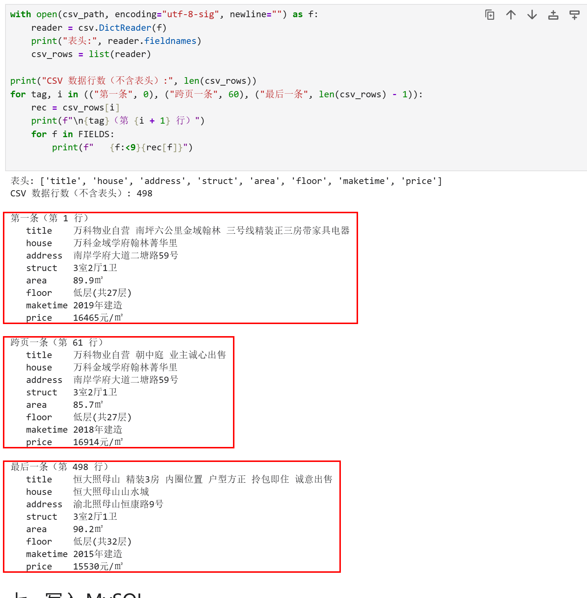

- 样本1（页码或URL、记录位置）：第 1 页第 1 条（CSV 第 1 行 / 数据库 id=2）：万科物业自营 南坪六公里金域翰林…，89.9㎡ / 低层(共27层) / 2019年建造 / 16465元/㎡
- 样本2（页码或URL、记录位置）：跨页一条（CSV 第 61 行，第 2 页第 1 条）：万科物业自营 朝中庭 业主诚心出售，85.7㎡ / 低层(共27层) / 2018年建造 / 16914元/㎡
- 样本3（页码或URL、记录位置）：最后一条（CSV 第 498 行，第 10 页末条）：恒大照母山 精装3房 内圈位置…，90.2㎡ / 低层(共32层) / 2015年建造 / 15530元/㎡

核对结论及差异：

三条样本在网页、CSV、数据库三处的 8 个字段完全一致，无差异。（注：数据库 id 从 2 开始，是因为此前验证流程曾插入并回滚过一次，自增计数器已消耗了 id=1，属正常现象，不影响数据内容。）

## 问题与解决

- 遇到的问题、处理方法及结果：
  1. **教学站返回验证页**：按说明用简单 UA（`Mozilla/5.0`）请求时，状态码 200 但页面是"访问验证-安居客"，房源数 0。改用完整浏览器 UA（含 Chrome/120.0.0.0 Safari/537.36）后返回真实房源页；并显式设置 `resp.encoding = "utf-8"` 防止乱码。
  2. **属性项顺序不固定**：面积、楼层、建造年代在 `p.property-content-info-text` 中的顺序会变，不能按位置取。改为按文字特征判断：含"㎡/平米"是面积、含"年建"是年代、含"层"是楼层，节点缺失返回空串。
  3. **MySQL 终端中文显示问号/花屏**：`mysql-console.bat` 默认字符集下中文变 `?`，试 `charset gbk` 反而花屏（终端本身是 UTF-8）。改用 `charset utf8mb4` 后中文显示正常。
  4. **compose 配置检查报 STUDENT_ID 为空**：课程 `.env` 中学号未填，补填后 `l05-mysql.ps1 -Action Start` 一次通过。
- 尚未解决的问题、未完成的步骤（没有可写"无"）：无。

## 思考题

1. 本次怎样实现下一页采集？结合自己的代码说明。

   答：在单元4 的 `while`/`for` 循环里，每请求并解析完一页后，用 `page_soup.select_one("a.next.next-active")` 找下一页按钮，`nxt.get("href")` 取出相对地址（如 `?page=2`），再用 `urljoin(url, href)` 拼成完整 URL 赋回 `url`，进入下一轮循环。当 `href` 为 None（末页）或达到 `MAX_PAGES=20` 时停止，并用 `stop_reason` 记录停止原因；`seen` 集合保证同一地址不会请求两次。

2. 旧代码把 out_list 定义在全局。你把结果列表放在哪里？为什么？

   答：我把总结果列表 `all_records` 放在单元4 主流程的开头（每次完整运行先清空为 `[]`），每页解析出的 `page_rows` 是循环内的局部变量，逐条 `append` 进去；`parse_row` 是纯函数，每次返回一个新字典。这样数据只在一个作用域里单向流动，重跑不会往旧列表里重复累加，也不会因全局状态残留导致数据翻倍，去重和入库前的条数统计才可信。

3. 你怎样获取建造年代？节点缺失或顺序改变时，怎样处理？

   答：不按位置取，而是遍历父容器属性区的所有 `p.property-content-info-text`，对每项取文字后按特征判断：含"年建"（如"2019年建造"）就记为 `maketime`。节点缺失时 `text_of()` 里的 `if node else ""` 会返回空串而不是报错；顺序改变也不影响，因为判断依据是文字内容而不是第几个节点。空串会照常入库，不会中断流程。

## 提交检查

- [x] 实验一原仓库的 `lab02/` 中已有源码、CSV、报告和真实截图。
- [x] 截图清楚，关键代码已框出，每项附有个人解释。
- [x] GitHub上能打开文件和图片，未上传个人账号密码、`.env`或教师答案。
- [x] 未完成项已如实说明；学习通只交原仓库链接。

如使用 AI，简述它帮助了什么，以及自己修改、运行和核对了什么：

在解析面积、楼层时取值出错，向 AI 咨询了排查方法，再自行定位到属性项顺序不固定这一问题并改写了取值逻辑。选择器由自己确定和修改，爬虫采集、Docker 环境配置、数据库建表均由自己完成，并执行了 498 条数据的入库与核对。
